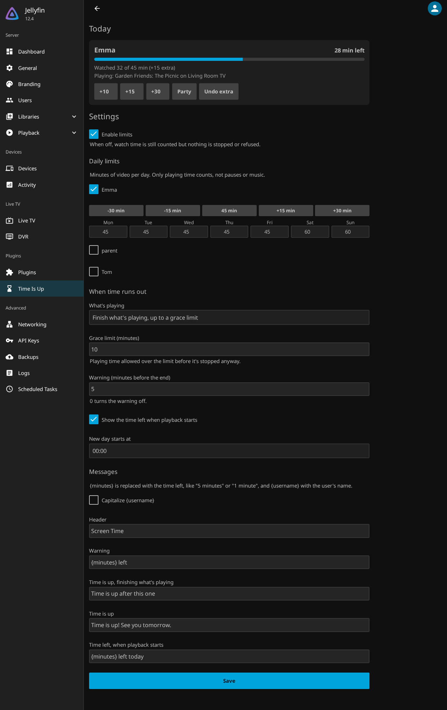

# Time Is Up

[](https://0rwx.com)

A Jellyfin plugin for daily screen time limits per user.

Built for Jellyfin 12.4 (.NET 10).

## Features

- **Daily limit per user**, set for each day of the week, with quick adjustment buttons.
- **Only actual watching counts**: paused video and music don't. Watching on two devices at once counts once.
- **New day at a set hour** in the server's local time. Usage is saved, so restarts don't reset it.
- **Warning** a set number of minutes before time runs out.
- **When time runs out**: stop right away, let the current video finish, or let it finish up to a grace limit (the default, 10 minutes), so a film can't run an hour over. A "Time is up after this one" message gives a heads-up.
- **New playback is refused** until the next day. The server answers "not allowed", so nothing starts playing.
- **Time left** is shown when playback starts (optional).
- **Extra time for today**: +10, +15, +30 or Party (no limit for the rest of the day). It expires when the new day starts.
- **Status at a glance** for every limited user: time watched and left, extra time, and what's playing on which device. The layout works on a phone.
- **Editable messages** with `{minutes}` ("5 minutes", "1 minute") and `{username}`.
- **Activity log entries** when time runs out and when extra time is added or removed.

The settings page is in the dashboard under Plugins → Time Is Up, for administrators only.



## Installation

In Jellyfin, open Dashboard → Plugins → Manage Repositories and add this repository:

```
https://code.hosaka.cc/hosaka/jellyfin-plugin-timeisup/raw/branch/main/manifest.json
```

Then install Time Is Up from the plugin catalog and restart Jellyfin. New versions show up as plugin updates.

## Building

Everything builds in containers, so only [podman](https://podman.io) and [just](https://just.systems) are needed:

```sh
just build   # dotnet publish into artifacts/
just dev     # build, then run a throwaway Jellyfin 12.4 with the plugin at http://localhost:8096
just media   # once: generate test videos into .dev/media
just setup   # once per fresh .dev/: admin dev/dev, user kid without a password, test libraries
just logs    # follow the dev server's log
just down    # remove the dev server, its config stays in .dev/
```

Release notes are kept with [changie](https://changie.dev) (`mise install` provides it). CI and releases are described in [.forgejo/README.md](.forgejo/README.md).


## AI Use

> | How | Why |
> | :--- | :--- |
> |  | [AI:X](http://0rwx.com) **Most of the project is written with the assistance of an LLM. I was not satisfied with existing built-in functionality or available plugins so I rolled my own.** |

## Credits

Based on the ideas and approach of [ScreenTime](https://github.com/atcen/jellyfin-plugin-screentime) by atcen (MIT). Scaffolded from [jellyfin-plugin-template](https://github.com/jellyfin/jellyfin-plugin-template).

## Mirrors
This repository is hosted on [Forgejo](https://code.hosaka.cc/hosaka/jellyfin-plugin-timeisup) which mirrors to the following git forges:
- [](https://github.com/hosaka/jellyfin-plugin-timeisup) - https://github.com/hosaka/jellyfin-plugin-timeisup

